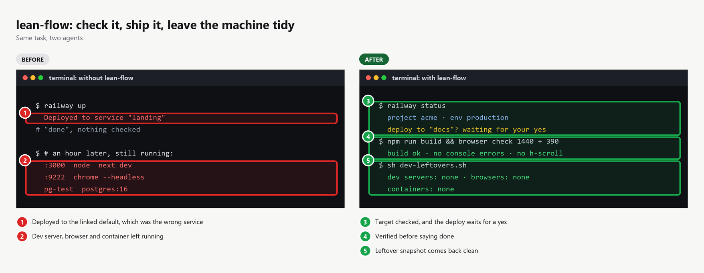
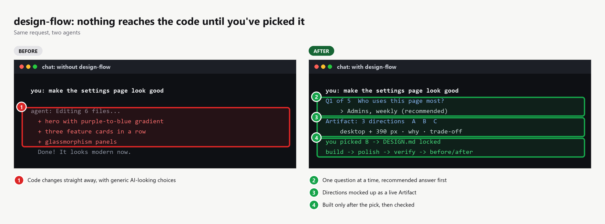
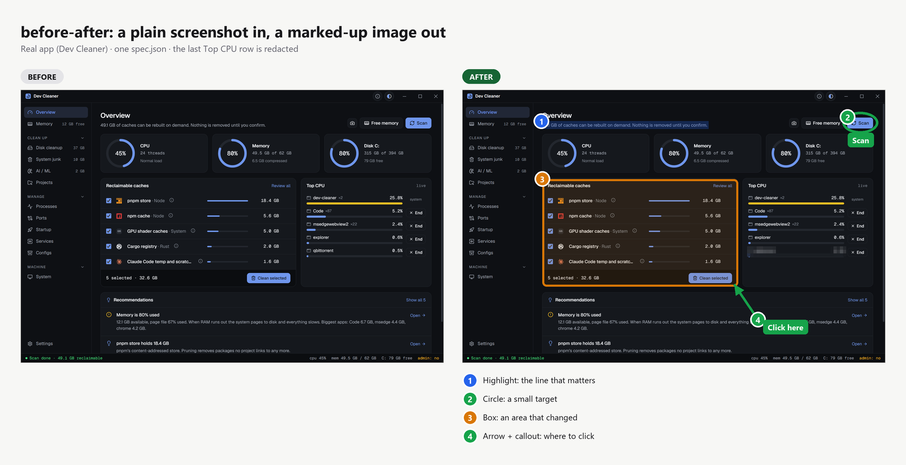
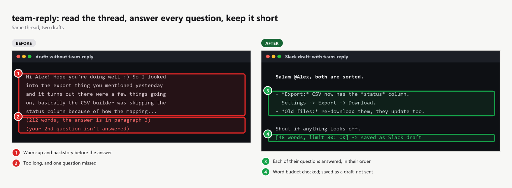
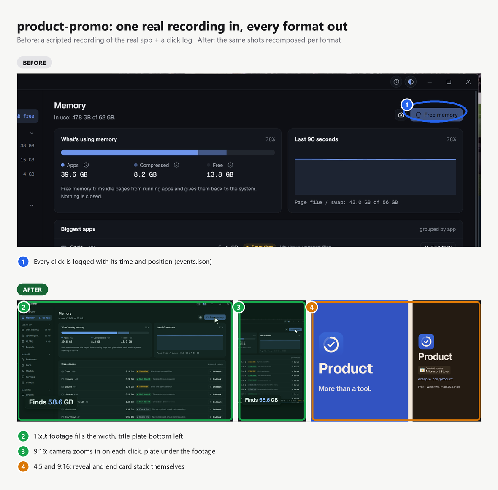

# skills

Agent skills I use every day, packaged so any agent that supports the open
[Agent Skills](https://agentskills.io) format can install them: Claude Code, Codex, Cursor and others.

## Skills

| Skill | What it does |
|---|---|
| [`lean-flow`](skills/lean-flow) | The dev loop around the code: GitHub CLI, verification and E2E with playwright-cli, Railway deploys and variables, safe use of any other platform CLI, and cleaning up dev servers, browsers and Docker containers afterwards |
| [`design-flow`](skills/design-flow) | UI design from brief to code: intake questions one at a time, two or three directions mocked up as a live Artifact, you pick, the system gets locked into `DESIGN.md`, then build, polish and verify. Hallmark first, and missing handoff skills get installed |
| [`before-after`](skills/before-after) | Before/after (or single) screenshots with numbered boxes, circles, arrows, highlights, callouts, redaction and a legend, rendered into one PNG with any capture tool |
| [`product-promo`](skills/product-promo) | A 20–45 s product promo from real captures, in 16:9, 9:16, 1:1, 4:5 or custom, all with the same feel. Three storylines to pick from, a locked SPEC, a camera that follows the recorded clicks, each format recomposed (HyperFrames) |
| [`team-reply`](skills/team-reply) | Collect the thread, answer every question in order, write in a configurable style (default: short, with a word budget per platform), format for Slack, Teams, WhatsApp, email or text. Drafts only |

## Install

With the [skills CLI](https://github.com/vercel-labs/skills):

```bash
npx skills add TriptoAfsin/skills --skill lean-flow -g     # global, for every project
npx skills add TriptoAfsin/skills --skill lean-flow        # current project only
```

Or by hand: copy `skills/lean-flow/` into `~/.claude/skills/` (Claude Code) or your agent's skills folder.

Update later with `npx skills update -g`.

## lean-flow



The loop I run around every change: **check it, ship it, leave the machine tidy.**
It holds conventions only. Command details come from the vendor skills it points to
(`playwright-cli`, Railway's official skills).

It uses progressive disclosure, so an agent loads a short `SKILL.md` every time and reads a reference only when it needs that one:

```
skills/lean-flow/
├── SKILL.md                 7 rules that always apply + which reference to read
├── references/
│   ├── github.md            remotes across orgs, commits, PRs, CI, releases, advisories
│   ├── verify-e2e.md        static → unit → build → browser at 1440 and 390 → E2E → after deploy
│   ├── railway.md           --service always, pushing to main means deploying, variable names only
│   ├── cloudflare.md        wrangler: --env always, data is local unless --remote, D1 migrations, secrets, deploys
│   ├── supabase.md          v3: local unless --remote, migrations dry-run first, secrets from a file
│   ├── cli.md               CLI first: pick the tool (detect, then ask once), then any CLI safely: read/write/destructive, dry-run, secrets
│   └── cleanup.md           snapshot before and after, servers, browsers, Docker, Rust target/
└── scripts/
    ├── dev-leftovers.sh     lists dev servers, headless browsers and containers still running (macOS/Linux, report-only)
    └── dev-leftovers.ps1    the same for Windows
```

The rules that matter most:

- CLI first. It doesn't assume your tools: it detects them from you, then the repo, then what's installed, and asks
  once if there's still a choice (for example `playwright-cli` vs `agent-browser`).
- The repo's own verify and deploy rules win over these defaults.
- Push, deploy, merge, release and variable changes need the user's yes. On Railway, pushing to `main` usually *is* deploying.
- Never print secrets, and never submit forms against live credentials while testing.
- A task isn't done until it has been checked, and the evidence goes in the answer.
- Only clean up what you started.

## design-flow



My design process as a skill. **Nothing reaches the codebase until I've seen it and picked it.**

```
0 pre-flight      read DESIGN.md / tokens / components; established system = fixed palette and type
1 intake          what · who + one action · tone · references · must-haves · how many directions
                  (one question at a time, recommended option first)
2 directions      2–3 that differ on at least two axes, via hallmark (study any reference URL or screenshot first)
3 artifact        one live page: brief, A/B/C switcher, desktop + 390 px frames, why / trade-off per direction
4 choose          pick, mix or comment; republish to the same URL; at most two rounds
5 lock            chosen system → DESIGN.md
6 build           frontend-design + the repo's own tokens and components
7 polish          emil-design-eng decision framework + make-interfaces-feel-better checklist
8 verify          lean-flow browser checks, hallmark audit, before-after for established products
```

It orchestrates other skills, so install them too:

```bash
npx skills add TriptoAfsin/skills --skill design-flow -g
npx skills add TriptoAfsin/skills --skill lean-flow -g
npx skills add nutlope/hallmark -g
npx skills add emilkowalski/skill -g
npx skills add anthropics/skills --skill frontend-design -g
npx skills add jakubkrehel/make-interfaces-feel-better -g
```

`before-after` (optional, for client-facing changes) is a separate skill. Without an Artifact tool, step 3 writes one self-contained HTML file instead.

## before-after



```bash
npx skills add TriptoAfsin/skills --skill before-after -g
```

Capture both states with whatever browser or device tool you have, write a small `spec.json`, then run
`scripts/compare.py` (Python 3 + Pillow). Marks come in colours by kind (added, changed, removed, note) and in shapes
(box, circle, highlight, arrow, redact), with optional callout labels. A single panel gives one annotated screenshot.

## team-reply



```bash
npx skills add TriptoAfsin/skills --skill team-reply -g
```

It reads the conversation first (the Slack connector, or a pasted Teams, WhatsApp or email thread), answers each
question in order, and formats the result with `scripts/fmt.py --to slack|teams|whatsapp|email|text --max-words N`.
The default style is mine: short, a bold-label bullet per point, and a word budget per platform. Override any part
of it with `~/.agents/team-reply.md` (for you) or `.messages/STYLE.md` (for one project). See
[`references/style.md`](skills/team-reply/references/style.md).

## product-promo



```bash
npx skills add TriptoAfsin/skills --skill product-promo -g
```

Needs the HyperFrames skills (`npx hyperframes skills update`). Brief, then capture with a click log, three storylines, a
SPEC, the master cut, then each extra format recomposed. `templates/` holds a footage shot, the reveal, the claim and
the end card. The last three adapt to any aspect ratio on their own. `scripts/scene_motion.py` turns the click log into
camera and cursor motion framed for each format.

## README images

Every image above is rendered by the `before-after` skill itself: `python docs/make-images.py` redraws the text cards,
and the specs in `docs/images/_src/` hold the rest.

## License

MIT
